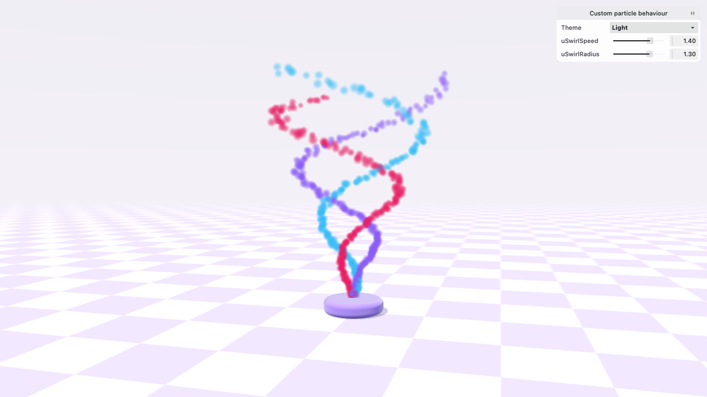

# Custom particle behaviour

A particle shader bit: motion of your own for a `ParticleSystem3D`, worked out in the vertex shader. Sparks rise from
a lilac clay pad in three coloured arms, sky, pink and purple, that swing out and wind round the pad's axis as they
climb. The CPU writes a spark once, when it's born, and every frame after that the shader works out where it is from
that record and the clock, so the swirl costs the CPU nothing and one uniform write re-winds every live spark at once.

## API

- `ShaderBit`: `swirlBit` is a plain object, plugged in with `extraBits`. Its `name` must be unique, since compiled
  shaders are cached by their bits' names.
- `attributes: { aSwirlPhase: 'float32' }`: a value every spark carries, written once when it's born. Declaring the
  bit with `satisfies ShaderBit` keeps the name in the type, so `spawn()` takes and checks it.
- `bindings.material` (`uSwirlSpeed`, `uSwirlRadius`): values the whole system shares, which become
  `sparks.uniforms`. Assigning one queues its upload, so the pane binds straight to them.
- `gpu` and `gl` `vertex.beforeTransform`: WGSL and GLSL that run after the built-in lifetime and motion bits, read
  their `particleAge` and `particleProgress`, and add the swirl to `position`.
- `spawn(1, { aSwirlPhase, color })` from `onUpdate`, at 75 sparks a second with `emitRate: 0`: steady emission
  writes 0 into a bit's own attribute, so each spark is spawned with its arm's phase, a third of a turn apart.
- `ParticleSystem3D` from `@pixi/3d/extras` with `space: 'local'`, so the bit's `position` is relative to the emitter
  and the swirl turns about its y axis; a narrow `ConeShape` keeps each arm thin.
- `createRandom: () => seededRandom('swirl')`: a seeded stream, so every run launches the same sparks.
- `autoUpdate: false` with `update(ticker)`; a life of bare `update()` steps before the first frame fills the swirl.
- `View3D`, `Mesh3D` and `Container3D`: the scene and the pad.
- `OrbitCamera` from `@pixi/3d/extras`: drag to orbit, low enough to look down into the spiral.
- `Application` from `pixi.js`.

## Controls

- Drag to orbit.
- Pane: `uSwirlSpeed` winds the three arms, and at 0 they stand as straight rays; `uSwirlRadius` sets how far out
  they swing, and at 0 the sparks rise straight up, as they would without the bit.

## Files

- `index.ts`: the lesson. The system, the spawning in `onUpdate`, and the pane on its uniforms.
- `swirlBit.ts`: the shader bit, in WGSL and GLSL.
- `scene.ts`: the clay launch pad.

From the theme kit (`examples/shared/theme/README.md`): `ThemeStage`, `ThemePane`, `LoadingScreen`, `fitPortrait`,
the palette, `sparkTexture()`, `clayMaterial` and `roundedCylinder`.

## See also

- [Particle system](../particles_basics/README.md): the built-in motion this bit runs after.
- [Particle container](../particles_container/README.md): the other way to move particles yourself, on the CPU.
- [Extra bits](../shaders_extra-bits/README.md): shader bits on a mesh's material.

## Reference image

`reference.png` is the page at 1280 × 720 on WebGPU and the light theme, 30 frames (0.48 s) after it comes up.
`npm run test:example-shots -- particles_custom-bits` checks the example against it on WebGPU and WebGL; add
`--update` to retake it after an intended change.
